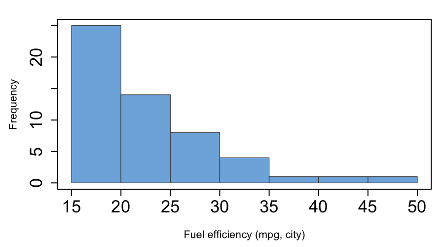
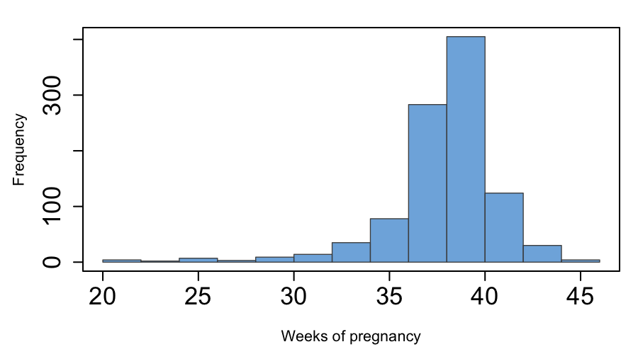
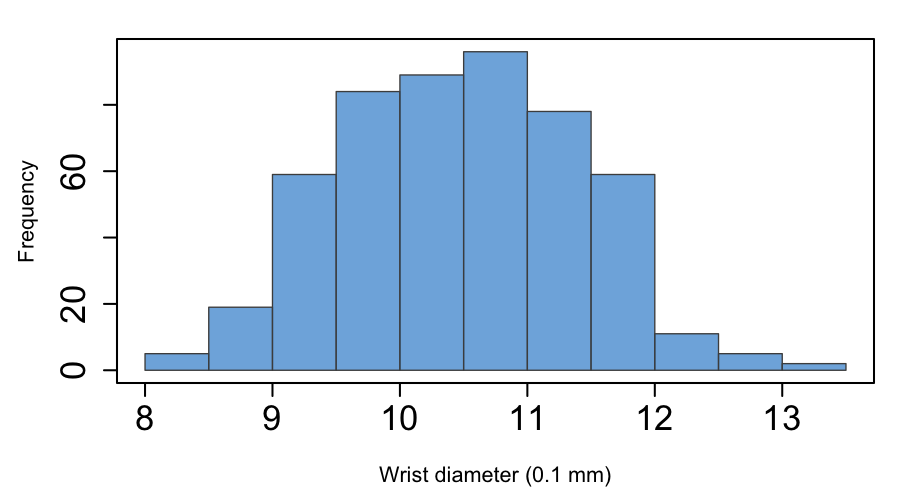

---
# Page for the MATH 1201 "Exploring AI Tools (chatbot)" assignment.
layout: default
title: Samples for AI Assignment
---

## Histogram samples for the AI assignment

Copy the links below and use them where described in the assignment.

### Image A

https://youngsukim-csusb.github.io/assets/ai_samples/ai_hist_A_mpg_city.png

### Image B

https://youngsukim-csusb.github.io/assets/ai_samples/ai_hist_B_gestation.png

### Image C

https://youngsukim-csusb.github.io/assets/ai_samples/ai_hist_C_wrist.png

---

Data source: the [openintro](https://openintrostat.github.io/openintro/reference/index.html) R package, OpenIntro.org (OpenIntro Statistics). Figures drawn in base R by Youngsu Kim.
